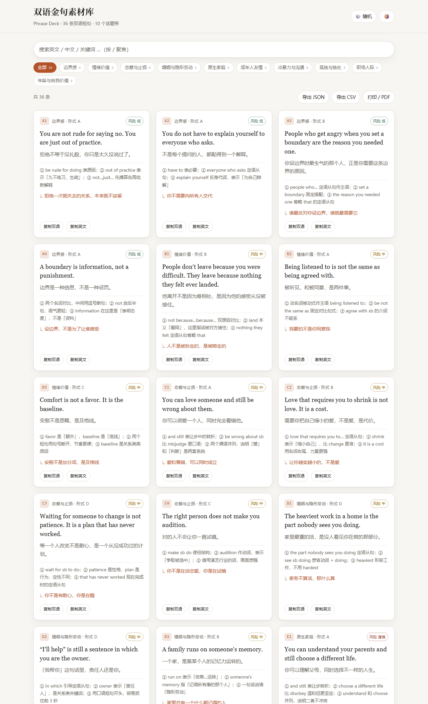

# 双语金句素材库 · Phrase Deck

> 36 条中英双语短句，按 10 个话题带整理，每条附**语法拆解**与**内容钩子**。
> 纯静态网页 + 零依赖 Python 构建脚本 —— 双击就能看，不装任何东西。



[](https://github.com/f240211320b-cyber/phrase-deck/actions/workflows/ci.yml)
[](https://github.com/f240211320b-cyber/phrase-deck/actions/workflows/pages.yml)
[](LICENSE)
[](tools/build.py)
[](#为什么不装依赖)

---

## 这是什么

一个可以自己维护的**双语素材库**样板工程：

- **网页端**：浏览、检索、按话题带筛选、随机抽一条、一键复制双语、导出 JSON / CSV、打印成 PDF。
- **构建端**：`tools/build.py` 把一个数据文件导出成 4 种格式 —— JSON、CSV、可打印 HTML、Word 文档。
- **数据端**：所有内容只在 `data/phrases.js` 一处，改完刷新页面即可生效，不需要编译。

适合用来：

- 做内容选题库 / 金句库 / 语料库，按话题归档；
- 当中英双语学习卡片的模板，替换成自己的句子；
- 作为「零依赖静态站点 + 标准库脚本」的最小工程范例。

## 特性

| | |
|---|---|
| 🚀 零构建 | 没有 npm、没有 webpack、没有 JIT，改完文件刷新就是最新 |
| 🐍 零依赖 | Python 侧只用标准库（`zipfile` 手写 OOXML 生成 docx） |
| 🔍 全文检索 | 搜英文、中文、语法要点、钩子、话题名都能命中，多关键词空格分隔 |
| 🎲 随机抽条 | 选题卡住时按一下，直接滚到那张卡 |
| 🌗 明暗主题 | 默认跟随系统，手动切换后记忆 |
| ⌨️ 键盘友好 | `/` 聚焦搜索，`Esc` 清空 |
| 🖨️ 打印即 PDF | 专门的打印样式，A4 分页不会把卡片劈开 |
| ✅ 有校验有测试 | 36 条数据的字段完整性、id 唯一性、中英文内容都有自动化检查 |
| ⚙️ CI + Pages | 附 GitHub Actions：PR 跑测试，main 分支自动发布网页 |

## 快速开始

**只想看效果**：双击 `index.html`。

> 因为数据用 `<script src="data/phrases.js">` 引入而不是 `fetch()`，
> 所以 `file://` 直接打开也能正常工作，不需要起服务器。

**想要更接近线上的体验**：

```bash
# 任选一个本地服务器
python -m http.server 8000
# 然后打开 http://localhost:8000
```

**生成导出文件**：

```bash
python tools/build.py           # 输出到 dist/
python tools/build.py --check   # 只校验数据
python tools/build.py --out out # 自定义输出目录
```

产物：

```
dist/
├─ phrases.json         完整数据
├─ phrases.csv          带 BOM，Excel 双击不乱码
├─ 双语金句素材库.html   单文件可打印页（Ctrl/⌘ + P 存 PDF）
└─ 双语金句素材库.docx   Word 文档
```

## 目录结构

```
phrase-deck/
├─ index.html                 页面骨架
├─ assets/
│  ├─ app.js                  渲染 / 筛选 / 复制 / 导出（无框架）
│  └─ style.css               样式（含深色主题与 print 样式）
├─ data/
│  └─ phrases.js              唯一数据源：window.PHRASES = { meta, bands, items }
├─ tools/
│  ├─ build.py                校验 + 导出 JSON / CSV / HTML / DOCX
│  └─ test_build.py           标准库 unittest，18 个用例
├─ .github/workflows/
│  ├─ ci.yml                  测试 + 构建校验
│  └─ pages.yml               发布到 GitHub Pages
├─ CONTRIBUTING.md
├─ LICENSE                    MIT
└─ README.md
```

## 数据结构

`data/phrases.js` 是一个普通的 JS 文件，内容是一个 JSON 对象：

```js
window.PHRASES = {
  meta:  { title, titleEn, description, version, license },
  bands: [ { code, name, note, form, risk } ],
  items: [ { id, band, form, en, zh, key, hook } ]
};
```

### `items[]` 字段

| 字段 | 必填 | 说明 |
|---|---|---|
| `id` | ✅ | 唯一编号，**必须以所属话题带代码开头**，如 `A1`、`J4` |
| `band` | ✅ | 所属话题带代码（对应 `bands[].code`） |
| `en` | ✅ | 英文原句，必须含英文字母 |
| `zh` | ✅ | 中文对照，必须含中文字符 |
| `form` | | 呈现形式 `A` 图文卡片 / `B` 慢速朗读 / `C` 手写特写 / `D` 录屏讲解 |
| `key` | | 语法 / 用法拆解，建议用 ①②③ 分点 |
| `hook` | | 一句话内容钩子，用于标题或封面 |

### `bands[]` 字段

| 字段 | 说明 |
|---|---|
| `code` | 单字母代码 `A`–`J`，同时决定筛选按钮顺序 |
| `name` | 话题名，如「边界感」 |
| `note` | 这个带为什么值得做（选题判断） |
| `form` | 主打呈现形式 |
| `risk` | 商用风险：`低` / `中` / `谨慎` |

### 新增一条素材

1. 在 `bands` 里找到话题带代码（没有就先加一个带）；
2. 在 `items` 末尾追加一条，`id` 接着编号往后排；
3. 跑 `python tools/build.py --check` —— 校验器会检查必填字段、id 唯一、
   id 前缀、中英文内容、英文重复等问题；
4. 刷新页面确认展示正常。

## 部署到 GitHub Pages

仓库推上去之后，在 **Settings → Pages → Build and deployment** 里把
**Source** 选成 **GitHub Actions**。之后每次 push 到 `main`，
`.github/workflows/pages.yml` 会自动把整站发布到：

```
https://<你的用户名>.github.io/<仓库名>/
```

不需要构建步骤 —— Pages 直接拿仓库根目录的静态文件。

## 开发

```bash
python tools/test_build.py      # 18 个用例：数据校验 / 各格式产物 / CLI
python tools/build.py --check   # CI 里跑的同一套校验
```

测试覆盖：数据加载、字段校验（必填 / 唯一 / 前缀 / 语言 / 重复）、
四种产物的结构与内容、CLI 退出码。

### 为什么不装依赖

生成 `.docx` 通常要用 `python-docx`，导出 PDF 通常要用 `reportlab` 或
LaTeX。这个项目把两件事都绕开了：

- **docx**：`zipfile` 按 OOXML 规范直接写 `[Content_Types].xml`、`document.xml`、
  `styles.xml`，30 行代码搞定，Word / WPS / LibreOffice 都能打开；
- **PDF**：不做，交给浏览器打印（`@media print` 样式已经调好）。

结果就是：**任何装了 Python 3.10+ 的机器，clone 下来就能跑**，
CI 也不需要 `pip install` 那一步。

## 贡献

见 [CONTRIBUTING.md](CONTRIBUTING.md)。一句话版本：
**改数据 → 跑检查 → 提 PR**。

## License

[MIT](LICENSE) · 素材内容仅供语言学习与内容创作参考。

---

## English summary

A zero-dependency bilingual phrase library: 36 EN/ZH sentences across 10 topic
bands, each with a grammar breakdown and a content hook.

- **Static site** — `index.html` + `assets/*` + `data/phrases.js`, opens from
  `file://`, no build step, no framework.
- **Build script** — `python tools/build.py` validates the data and exports
  JSON, CSV, a printable HTML page and a real `.docx` (hand-written OOXML via
  the standard library, no `python-docx`).
- **Tests** — `python tools/test_build.py` (stdlib `unittest`, 18 cases).
- **CI/CD** — GitHub Actions runs the tests on every push and deploys the site
  to GitHub Pages from `main`.

Add a phrase by appending an entry to `items` in `data/phrases.js`, then run
`python tools/build.py --check`.
